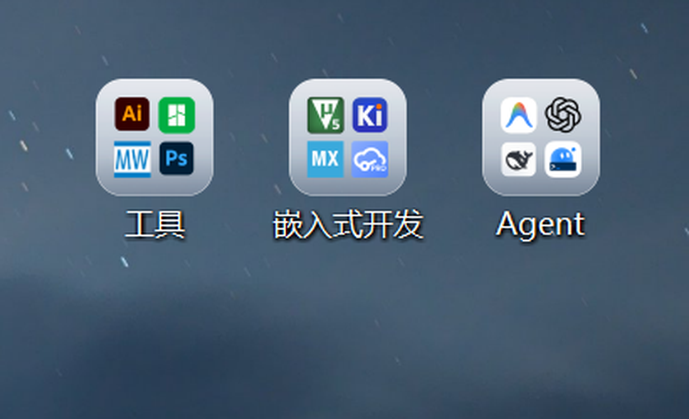
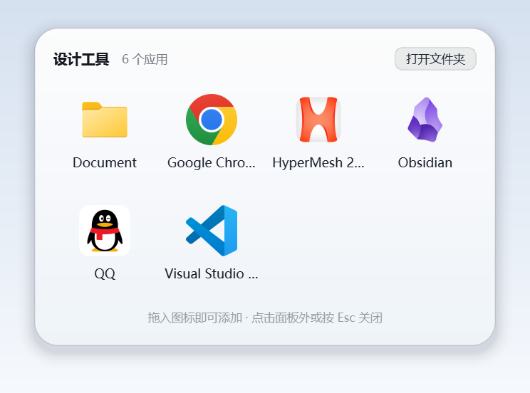
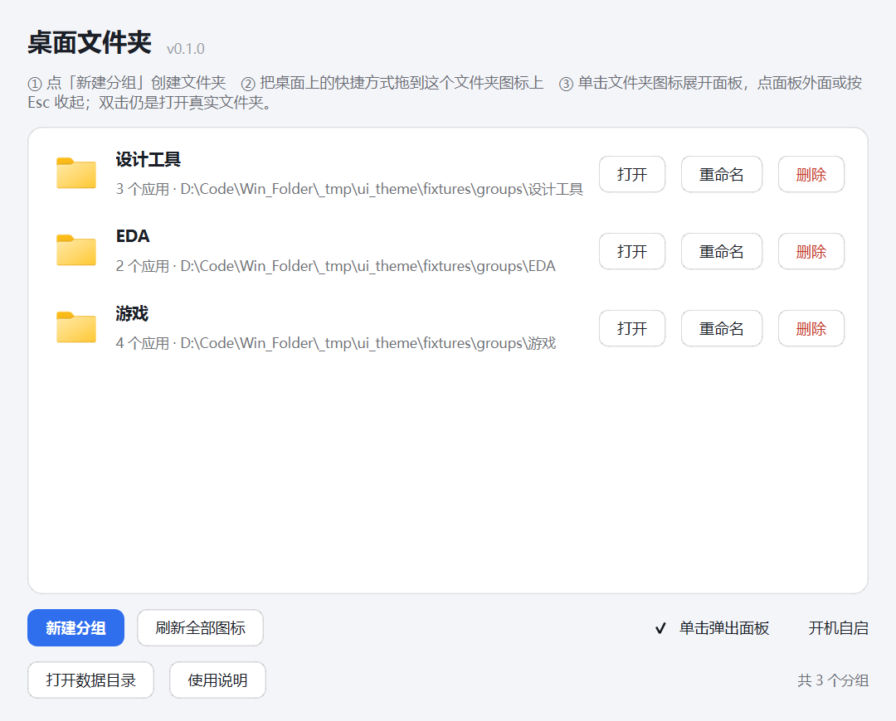
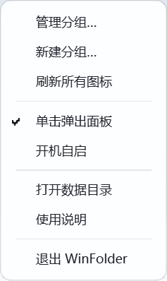
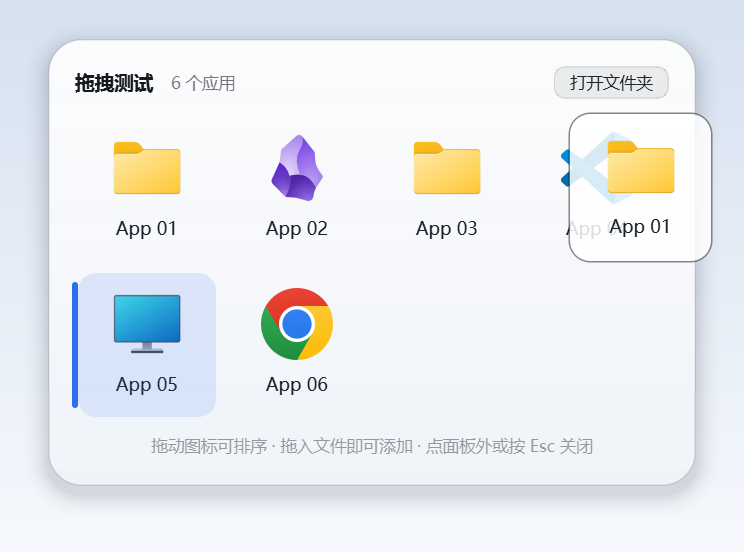

# WinFolder · Windows 桌面上的「安卓文件夹」

把桌面上散落的软件快捷方式收进**文件夹**，像手机桌面一样：**单击文件夹图标 → 弹出应用网格，点外面收回**。文件夹图标上会实时生成 2×2 的应用图标预览，桌面上只占 1 个格子。

> 分组就是 Windows 上真实存在的普通文件夹：拖进去、拖出来、F2 改名、Ctrl+Z 撤销都照旧；退出 WinFolder 后仍可用资源管理器访问。

桌面上分组文件夹的样子（2×2 应用预览，液态玻璃卡片）：



卡片细节（图标自动裁边放大，视觉大小统一）：


单击后弹出应用面板（浅色模式）：



界面会跟随 Windows 的浅色 / 深色模式自动切换：






## 快速开始

首次使用先按下方「源码部署」配置本机 Python。也可以直接让 agent 读取 [AGENTS.md](AGENTS.md) 完成安装。

1. 双击 **`启动 WinFolder.vbs`**（不会弹控制台，托盘出现 WinFolder 图标，首次启动会打开管理窗口）。
2. 点 **「新建分组」**，比如起名 `设计工具`、`EDA`、`AI 编程`、`游戏`，桌面上会出现对应的文件夹。
3. 把桌面上的快捷方式**拖到这个文件夹图标上**，图标里的 2×2 预览会自动更新。
4. **单击**桌面上的分组文件夹图标 → 在鼠标旁弹出应用面板；单击应用启动；点面板外面 / 按 Esc 收起。
5. 想批量整理时，**双击**文件夹图标还是打开真实文件夹，和普通文件夹完全一样。

## 交互细节

| 操作 | 行为 |
| --- | --- |
| 单击分组文件夹图标 | 弹出应用面板（可在托盘里暂停该行为） |
| 双击分组文件夹图标 | 打开真实文件夹（Windows 原生行为） |
| 面板内拖动应用图标 | 调整面板顺序（也决定卡片上 2×2 预览的顺序），保存到分组的 `.wf\order.json` |
| 面板失去焦点（Alt+Tab / 点其他窗口） | 自动收起，不用再点一下桌面 |
| 拖快捷方式到文件夹图标 | 原生移动进分组，预览图标自动刷新 |
| 单击面板里的应用 | 启动程序，面板自动收起 |
| 单击面板外面 / 按 Esc | 收起面板 |
| 右键面板里的应用 | 打开 / 打开文件所在位置 / 移出到桌面 / 删除到回收站 |
| 右键面板空白处 | 打开文件夹 / 刷新图标 |
| 托盘菜单 | 管理分组、新建分组、刷新所有图标、暂停单击弹出、开机自启、打开数据目录、退出 |

面板内拖动排序示意（拖动时 ghost + 插入位置高亮）：



## 管理窗口

- 列出所有分组、应用数量、真实路径
- 新建 / 重命名 / 删除分组（删除时文件、子文件夹和隐藏项会**移回桌面**；搬移失败则停止并保留剩余内容）
- 一键刷新所有分组图标
- 勾选开机自启、单击弹出面板
- 界面跟随系统浅色 / 深色模式自动切换

## 工作原理

```
桌面分组文件夹（真实目录，带 READONLY 属性）
├── 快捷方式们 .lnk
├── desktop.ini          ← IconResource 指向生成的 .ico
└── .wf\                 ← 隐藏的元数据目录
    ├── group.json       ← 分组 ID / 创建时间
    ├── order.json       ← 面板里拖动排序后的应用顺序（可选）
    ├── icon.sig         ← 内容签名（用于判断是否需要重画图标）
    └── icons\*.ico      ← 2×2 应用预览的文件夹图标
```

- **图标**：用 `IShellItemImageFactory::GetImage(256)` 拿满幅应用的图标（对 UWP/商店版快捷方式额外解析 AUMID 兜底），按 alpha 内容裁边、放大统一视觉大小；再合成为带通透质感的**液态玻璃卡片**（竖向半透明白渐变 + 顶部高光描边 + 内侧柔光，圆角 56/256），保留 alpha 让壁纸透出来。1/2/3/4 个应用有各自布局，2×2 不再挤在一起。最后写到 `desktop.ini` 的 `IconResource`；文件夹设置为 `READONLY` 是 Windows 自定义文件夹图标的系统要求（不影响往里放文件）。
- **单击检测**：UI Automation (`ControlFromPoint`) 判断鼠标下是否是桌面上的分组图标；区分拖拽/双击/其他窗口，避免误触发。本进程不会注入任何键盘/鼠标事件。
- **面板**：PySide6 无边框透明窗口（`Qt.Popup`），点击外部自动关闭；图标 48px、4 列网格、超过 16 个可滚动；浅色模式为白玻璃 + 深色文字，深色模式为深色玻璃。
- **主题**：`theme.py` 读取注册表 `AppsUseLightTheme` 判断系统深浅色，每 3.5 秒轮询，切换时实时更新托盘菜单、管理窗口、对话框和面板（也可用环境变量 `WINFOLDER_THEME=light|dark` 临时覆盖）。
- **后台刷新**：定时扫描分组内容变化，在后台线程重画图标；托盘常驻，单实例运行。

## 源码部署

面向自己的 Windows 电脑使用，仓库只分发源码，不附带 Python/Qt 安装包。已验证 Windows 11 + 64 位 Python 3.12；其它系统和 Python 版本需在目标电脑实测。

每台电脑的环境可以不同。让 agent 优先使用本机已有环境，补齐 `requirements.txt` 中的 PySide6、Pillow、uiautomation 和 comtypes，再配置启动路径。

可以直接把这句话交给 agent：

> 请将 https://github.com/Persenz1/WinFolder 部署到我指定的目录，按仓库 AGENTS.md 复用本机 Python 环境、补齐依赖、配置 pythonw.path，并验证启动。新建环境前先问我。

手动部署时，在仓库目录执行以下 PowerShell 命令，先将示例解释器路径替换为本机实际路径：

```powershell
$winFolderPython = 'C:\实际环境目录\python.exe'
& $winFolderPython -m pip install -r requirements.txt
$winFolderPythonw = Join-Path (Split-Path $winFolderPython) 'pythonw.exe'
Set-Content -LiteralPath .\pythonw.path -Value $winFolderPythonw -Encoding Unicode
Start-Process -FilePath wscript.exe -ArgumentList '"启动 WinFolder.vbs"' -WindowStyle Hidden
```

`pythonw.path` 只保存本机 `pythonw.exe` 的绝对路径，不加引号，使用 UTF-16LE 编码；它不会上传到 GitHub。换电脑时重新配置该文件即可，不必改程序源码，也不必修改全局 PATH。

更新代码时保留该文件，退出 WinFolder、更新仓库，再重新启动。移动项目目录或更换解释器后，若之前开启了开机自启，需要重新登记自启路径，具体见 [AGENTS.md](AGENTS.md)。

## 文件结构

```
Win_Folder/
├── run.pyw                  # 启动入口（pythonw，无控制台）
├── 启动 WinFolder.vbs       # 双击启动
├── pythonw.path             # 本机解释器路径，不提交 Git
├── AGENTS.md                # agent 安装、迁移与维护说明
├── winfolder/
│   ├── app.py               # 托盘 + 控制器（点击 → 面板 → 图标刷新）
│   ├── groups.py            # 分组模型（创建/重命名/删除/扫描）
│   ├── icons.py             # 图标提取 + 液态玻璃卡片合成 + desktop.ini 应用
│   ├── watcher.py           # 桌面单击检测（UIA）
│   ├── popup.py             # 安卓式弹出面板（双主题）
│   ├── manager.py           # 管理窗口（双主题）
│   ├── theme.py             # 系统深浅色检测 + 调色板 / QSS
│   ├── dialogs.py           # 主题化输入框 / 提示框
│   ├── config.py            # 设置与数据目录
│   ├── autostart.py         # 开机自启（HKCU Run）
│   └── util.py              # Win32 小工具
├── requirements.txt
└── docs/
```

## 数据与卸载

- 设置、日志、图标缓存：`%APPDATA%\WinFolder\`
  - 日志：`winfolder.log`（排查问题先看这里）
  - 图标缓存：`icon_cache\`（可随时删除，会自动重建）
- 卸载：
  1. 托盘右键 →「退出 WinFolder」（先关掉开机自启以免它再启动）
  2. 把分组里的快捷方式拖回桌面，或直接删除空的分组文件夹
  3. 删除 `%APPDATA%\WinFolder` 和项目目录
- 分组文件夹上多出的 `.wf` 隐藏目录、`desktop.ini`、`READONLY` 属性都是 WinFolder 的标记；移除 `.wf` 会使文件夹不再被识别为分组，但不会自动清除 `desktop.ini` 的图标设置。

## 已知限制

- **只能占 1 个桌面格子**：文件夹图标是 Windows 原生文件夹图标，无法实现自绘的 2×2 四格磁贴（那需要接管整个桌面渲染层，风险和复杂度高很多）。
- 分组图标最多展示前 4 个条目（优先使用拖动保存的顺序，其余按名称自然排序），多于 4 个时打开面板查看全部。
- 少数程序的 exe 只带 48×48 小图标（例如 Bambu Studio / ManuWare / QuickDAQ），放大到卡片后会有轻微模糊，属于图标资源本身的限制。
- 商店（UWP/MSIX）应用的快捷方式通过解析官方 AUMID 取图标；个别特殊应用若既没有可解析的 AUMID 也没有目标路径，只能显示通用图标。
- 液态玻璃卡片是半透明的，在**纯浅色**壁纸上对比度会偏低一些（深色/照片壁纸效果最好）。
- 单击弹面板依赖 UI Automation；个别远程桌面/全屏独占场景可能失效（此时双击仍可打开真实文件夹）。
- 双击分组图标时，Windows 仍会按原生行为打开文件夹窗口（面板会随之收起）。
- 分组文件夹被设为只读属性属于正常现象（自定义文件夹图标的要求），不影响往里拖文件。
- 主题跟随系统浅色/深色设置，暂未提供手动切换；用 `WINFOLDER_THEME=light|dark` 环境变量可强制。
- 开机自启记录的是 `pythonw.exe` 和本项目 `run.pyw` 的绝对路径；移动项目目录后需要在托盘里重新勾选一次开机自启。

## 故障排查

| 现象 | 处理 |
| --- | --- |
| 桌面分组图标里的应用预览是白页 | 新版已内置"通用图标检测 + 重试 + 解析目标回退"，正常不会出现；若遇到右键面板空白处 →「刷新图标」，或托盘「刷新所有图标」 |
| 双击进入分组文件夹，个别快捷方式图标白页 | 这是 Windows 图标缓存的刷新延迟（通常几秒~几分钟），按 F5 或重新打开文件夹即可；不是分组数据问题 |
| 托盘菜单/新建分组窗口配色异常 | 新版跟随系统深浅色自动切换；若仍异常，退出重启 WinFolder 并查看 `winfolder.log` |
| 点面板里的应用没反应/闪一下 | 若 WinFolder 是从 VS Code 等 Electron 宿主终端启动的，环境里可能带 `ELECTRON_RUN_AS_NODE`，会让 Electron 应用秒退；启动时会自动清理这些变量。仍失败时看 `%APPDATA%\WinFolder\winfolder.log` |
| 启动提示 Python 路径缺失或无效 | 请 agent 按「源码部署」重写本机 `pythonw.path`，并在选定环境中补齐依赖 |
| 单击文件夹图标没反应 | 托盘确认「单击弹出面板」是勾选状态；查看 `%APPDATA%\WinFolder\winfolder.log`；某些全屏/远程桌面环境 UIA 不可用 |
| 图标不更新 | 托盘「刷新所有图标」；确认分组文件夹里有内容变化；Windows 图标缓存偶尔延迟几秒 |
| 想临时关掉单击弹出 | 托盘菜单 →「单击弹出面板」取消勾选（双击/拖放仍可正常管理文件夹） |

## 开发

模块公开 API 约定（供二次开发）：

- `icons.extract_icon(path) -> PIL.Image | None`、`icons.apply_group_icon(group_dir, app_paths) -> bool`
- `watcher.ClickWatcher(group_names_provider)` → `group_clicked(str,int,int)` / `desktop_clicked(int,int)`
- `popup.get_popup().open_group(group_name, folder_path)` / `closed` 信号
- `groups.discover_groups()` → `Group` 列表；`groups.create_group(name)` / `delete_group(group)`

单独调试弹出面板：

```bash
python winfolder/popup.py "C:\Users\<你>\Desktop\某个分组"
pythonw run.pyw                 # 完整应用（无控制台）
```
